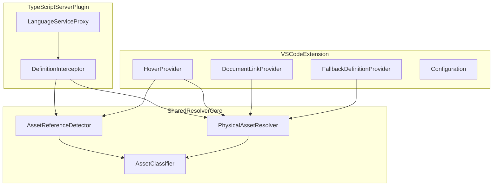

# Asset Import Navigator — PRD & Implementation Plan

**Status:** Authoritative product + engineering plan — **Phases 0–7 complete (release candidate)**; operator checks and first GitHub CI run pending — see `docs/phase-7-findings.md`  

**Scope:** TypeScript / TSX / JavaScript / JSX projects; Vite-oriented asset imports as the primary target  
**Primary goal:** Make frontend asset imports behave like real source-file references in VS Code instead of navigating to ambient declaration files such as `client.d.ts`.  
**License:** MIT  
**Extension display name:** `Asset Import Navigator`  
**Extension id:** `asset-import-navigator`  
**Publisher:** `PUBLISHER_TODO` (human must set before Marketplace publish)

---

## How to use this document

| Audience | Read |
|---|---|
| Product / stakeholders | **Part A** |
| Architects / reviewers | **Part B** |
| AI coding agents / implementers | **Part B contracts** + **one Phase section** at a time |

**Agent rule:** Implement exactly one phase per session. Use Part B contracts plus that phase’s template only. Do not invent features, change frozen interfaces after Phase 2, or skip acceptance criteria.

**Default workflow:** Sequential Phases 0 → 7. Parallel agents (A–G) are optional only after Phase 2 contracts freeze.

---

# Part A — Product Requirements (PRD)

## A.1 Problem statement

Frontend developers on Vite + TypeScript/React routinely import non-TypeScript assets:

```ts
import Icon from '@/assets/icons/exceptional_trader.svg?react';
import logo from '@/assets/logo.svg';
import styles from './Card.module.scss';
import './global.scss';
```

The application builds because Vite and plugins understand these module specifiers. VS Code delegates JS/TS navigation and hover to the TypeScript language service, which often only knows ambient wildcard modules:

```ts
declare module '*.svg?react' {
  const Component: React.FunctionComponent<React.SVGProps<SVGSVGElement>>;
  export default Component;
}
```

### User-visible failures

| ID | Failure | Expected | Actual (typical) |
|---|---|---|---|
| F-A | Go to Definition on import identifier | Open physical asset | Open `client.d.ts` / `vite-env.d.ts` |
| F-B | Click / Go to Definition on module specifier | Open physical asset | Inconsistent; often declaration |
| F-C | Modifier-key definition preview | Preview physical asset | Preview declaration file |
| F-D | Ordinary hover | Asset path / SVG preview / metadata | Declaration-type hover only |

**Product thesis:** Given a static frontend asset import in a JS/TS file, resolve the physical source file and make navigation, document links, and hover point there—not at ambient declarations—without replacing Vite, CSS Modules IntelliSense, or TypeScript typing.

---

## A.2 ICP and personas

### Ideal customer profile

| Dimension | Definition |
|---|---|
| Who | Frontend / fullstack engineers building SPAs or component libraries |
| Stack | Vite + TypeScript + React/JSX; often SVGR-style `?react` / `?url` / `?raw` and CSS/SCSS modules |
| Editor | VS Code (stable), bundled or workspace TypeScript |
| Pain | Asset imports navigate to ambient `.d.ts`; weak hover vs JetBrains |
| Adoption | Individual Marketplace install; optional workspace recommendations |
| Success | One gesture from import → real file; hover shows useful asset context |

### Personas

- **P1 — Vite React UI engineer (primary):** Heavy `*.svg?react` and `*.module.scss` usage; needs jump-to-asset and SVG glance-preview.
- **P2 — Design-system maintainer:** Alias maps (`@/`, `@assets/`) and shared asset folders; needs alias-aware resolution.
- **P3 — Team DX advocate (influencer):** Compares VS Code to WebStorm; cares that normal TS navigation is untouched.

### Competitive note

WebStorm performs resource-aware navigation for many asset imports. This extension closes that specific VS Code gap for static asset imports. It does not aim to replicate the full JetBrains frontend tooling suite.

---

## A.3 Jobs to be done

### Primary JTBD

> When I Cmd/Ctrl+Click or Go to Definition on an imported asset in a TS/JS file, I want to open the physical source file (not `client.d.ts`), so I can edit or inspect the real asset without leaving my coding flow.

### Supporting JTBDs

1. **Hover for context** — Confirm the right asset (path, type, SVG preview) without opening the file.
2. **Clickable import path** — Document link on the module specifier opens the physical asset.
3. **Alias-correct resolution** — `tsconfig`/`jsconfig` paths (and optional configured Vite-style aliases) resolve to the same physical file for static path cases.
4. **Honest Mode B** — When the tsserver plugin cannot load, document links and fallback still help, with documented limitations.

---

## A.4 User journeys

### Happy path A — SVG `?react` (Mode A)

1. Open TSX with `import Icon from '@/assets/icon.svg?react'`.
2. F12 / Cmd+Click on `Icon` or the specifier.
3. tsserver plugin returns physical `src/assets/icon.svg` as primary definition.
4. Hover shows path + safe SVG preview + Open action.

### Happy path B — SCSS module + document link

1. `import styles from './Card.module.scss'`.
2. Click document link or Go to Definition on import.
3. Opens `Card.module.scss`; hover shows physical-file metadata.

### Happy path C — Mode B fallback

1. Environment does not load contributed `typescriptServerPlugins` (e.g. native/tsgo path).
2. Extension detects Mode B; document links open the physical asset.
3. Fallback definition may be additive; README/debug state limitations honestly.
4. Developer still reaches the asset via the specifier link.

### Edge cases

| Scenario | Expected behavior |
|---|---|
| Missing physical file | No fabricated target; fall back to normal TypeScript |
| `?url` / `?raw` / `?react` | Resolve to physical file without query |
| `import './global.scss'` | Navigate/link to physical stylesheet |
| Unsupported / non-asset position | Silent pass-through |
| Multi-root workspace | Resolve from importing file’s folder / applicable config |
| Oversized / scripted SVG | Navigation works; hover degrades to metadata |
| Vite-only alias not in tsconfig | Only via `assetImportNavigator.aliases` |
| Normal TS symbol / `styles.foo` | Unchanged; `styles.foo` owned by other extensions |

---

## A.5 Goals and required outcomes

1. **Navigation** — Cmd/Ctrl+Click, F12, Go to Definition on supported asset imports open the physical source (Mode A primary; Mode B per truth table).
2. **Hover / preview** — Useful physical-asset hover; SVG visual preview when safe.
3. **Definition preview** — In Mode A, modifier-key preview targets the physical asset, not `client.d.ts`.
4. **Non-interference** — Ordinary TS/JS, package, and legitimate `.d.ts` navigation unchanged.

---

## A.6 MVP scope vs non-goals

### MVP must-haves

| Capability | In MVP |
|---|---|
| Mode A: tsserver plugin redirects definition to physical asset | Yes |
| Mode B: DocumentLink + narrowly scoped fallback DefinitionProvider | Yes |
| Hover: path/type; safe SVG preview | Yes |
| Relative + `tsconfig`/`jsconfig` paths + configured aliases | Yes |
| SVG (+ Vite queries), CSS/SCSS/Sass/Less (module + plain) | Yes |
| Non-interference with ordinary TS navigation | Yes |

### Non-goals (explicit)

- Do not execute `vite.config.ts` or reproduce the Vite plugin pipeline.
- Do not replace CSS Modules IntelliSense (`styles.className` → selector).
- Do not become a general TypeScript language server replacement.
- Do not hijack arbitrary string literals or `fetch('/assets/…')`.
- Do not globally suppress `.d.ts` navigation.
- Do not claim Mode A parity under native/tsgo until Phase 0 proves it.
- Do not ship multi-IDE support (JetBrains, Neovim) in v1.

### Deferred (not v1 blockers)

- Dynamic `import()` with static string literal
- Images/fonts/`?raw` text as first-class hover kinds
- Static parsing of simple Vite alias declarations
- Selector counting in stylesheet hover

---

## A.7 Success metrics

| Metric | Target |
|---|---|
| Definition success on fixture suite (Mode A, present files) | 100% |
| Ambient declaration as useful Mode A target for supported present assets | 0% |
| Mode B: document link opens physical file for same fixtures | Required |
| Non-regression on ordinary TS navigation fixtures | Zero intentional changes |
| Dogfood: time-to-asset from import | One gesture / under ~2s |
| GitHub issues tagged “still opens client.d.ts” after Mode docs | Trending down |

Qualitative: 5–10 Vite+React developers confirm asset navigation is good enough for daily VS Code work.

---

## A.8 Product risks and assumptions

| Risk / assumption | Level | Mitigation |
|---|---|---|
| Classic tsserver plugin can replace definition targets | High (validate Phase 0) | Hard gate; STOP if false |
| Native/tsgo does not load plugins | High | Mode B + honest docs |
| Provider aggregation in Mode B | High | Document links as reliable path; do not over-claim |
| Alias mismatch vs Vite | Medium | Explicit settings; no Vite exec |
| SVG preview security | High | Sanitize / size limit / fail to metadata |
| Scope creep into CSS Modules IntelliSense | Medium | Hard non-goal |

---

## A.9 MVP product acceptance criteria

Maps to master AC IDs in Part C.

| Product criterion | Master AC |
|---|---|
| Mode A: Go to Definition on supported present asset opens physical file | NAV-01…NAV-06, NAV-09 |
| Mode B: document links open physical file | NAV-07 |
| Queries strip to physical path | RES-05 |
| Relative + tsconfig aliases work | RES-01…RES-04 |
| Hover shows physical asset / safe SVG preview | HOV-01…HOV-04 |
| Ordinary TS navigation unchanged | NINT-01…NINT-05 |
| README states Mode A/B limitations and non-goals | DOC-01…DOC-04 |

---

# Part B — Solution Architecture & Contracts

## B.1 Architecture decision

**Primary navigation mechanism:** a TypeScript language-service / tsserver plugin that replaces definition results for supported asset imports **before** VS Code receives them.

**Not primary:** a normal VS Code `DefinitionProvider` alone — VS Code aggregates providers and cannot reliably silence the built-in TypeScript result.

**Hybrid stack:**

```text
VS Code Extension
├── TypeScript Server Plugin     → definition rewrite (Mode A)
├── Extension Host               → hover, document links, fallback definition, config, debug
└── Shared Resolver Core         → detect, normalize, resolve, classify (env-neutral)
```



### Mode A / Mode B truth table

| Capability | Mode A (classic tsserver plugin loaded) | Mode B (plugin unavailable / native TS) |
|---|---|---|
| Go to Definition primary target = physical asset | **Required** | Best-effort additive only; may coexist with `.d.ts` |
| Modifier-key definition preview | **Required** physical asset | Document observed behavior; do not claim parity |
| Document link on specifier | Required | **Required** (primary reliable path) |
| Hover physical-asset section | Required | Required |
| README claims | Full navigation | Explicit limitations section |

---

## B.2 Locked engineering decisions

| Decision | Value |
|---|---|
| Package shape | Single VS Code extension package (not npm workspaces) |
| Unit tests | Vitest |
| Integration tests | `@vscode/test-electron` |
| License | MIT |
| Parser | TypeScript compiler API only (no regex as primary parser) |
| Query policy default | `strip-for-supported-extension` |
| v1 extensions | `.svg`, `.css`, `.scss`, `.sass`, `.less` |
| Workflow | Sequential Phases 0→7 by default |
| Contract freeze | After Phase 2 acceptance |
| Publisher | `PUBLISHER_TODO` until human sets it |

**Never:**

- Execute `vite.config.ts`
- Globally filter `.d.ts` definitions
- Implement `styles.foo` selector navigation
- Recursively scan the workspace to guess assets
- Invent a real Marketplace publisher id

---

## B.3 Asset model

### Supported v1

- SVG: `.svg`, `.svg?react`, `.svg?url`, `.svg?raw` (queries configurable)
- Stylesheets: `.css`, `.scss`, `.sass`, `.less`, and `*.module.*` variants

### Architecture-ready later (not v1 mandatory)

`.png`, `.jpg`, `.jpeg`, `.webp`, `.gif`, `.avif`, `.ico`, `.woff`, `.woff2`, `.ttf`, `.json?raw`, `.txt?raw`

### Classification types

See **B.8 Core contracts**.

Example:

```text
Original:  @/assets/icon.svg?react
Physical:  @/assets/icon.svg
Query:     react
Kind:      svg
```

---

## B.4 Import / reference detection

### Supported syntax (v1)

```ts
import Icon from './icon.svg?react';
import * as icons from './icons.svg';
import styles from './Button.module.scss';
import './global.scss';
export { default as Icon } from './icon.svg?react';
export * from './theme.css';
```

### Parser rules

- Use TypeScript AST for TS/TSX/JS/JSX.
- Regex only for narrow query/hash splitting after specifier extraction.
- Prefer false negatives over incorrect navigation.
- Do **not** treat string literals or `fetch('/assets/…')` as imports.

API:

```ts
findAssetReferenceAt(sourceFile, position): AssetReference | undefined
```

Position may be: imported local identifier, module-specifier string, or exported identifier whose source is the asset module.

---

## B.5 Module resolution pipeline

Given `@/assets/icons/foo.svg?react`:

1. Parse module specifier.
2. Split query and hash.
3. Preserve query metadata.
4. Physical candidate: `@/assets/icons/foo.svg`.
5. Classify extension; reject unsupported.
6. Resolve relative path **or** alias.
7. Verify physical resource exists.
8. Return canonical URI.

**Resolution order:**

1. Relative imports (against importing file directory)
2. Applicable `tsconfig.json` / `jsconfig.json` `baseUrl` + `paths` (nearest for importing file; support `extends`, wildcards, multiple targets in order)
3. Configured extension aliases (`assetImportNavigator.aliases`)

**Do not** execute `vite.config.ts`.

**Query policy default:** strip query for supported extensions (`icon.svg?react` → `icon.svg`).

**Filesystem:** shared core uses `AssetResolverHost` only. Adapters:

- Extension host → `vscode.workspace.fs`
- tsserver plugin → TypeScript server host

---

## B.6 Navigation behavior

### Required UX (Mode A)

For `import Icon from '@/assets/icon.svg?react'`:

- Cmd/Ctrl+Click and F12 on `Icon` → physical SVG
- Cmd/Ctrl+Click and Go to Definition on specifier → physical SVG

For `import styles from './Card.module.scss'` → `Card.module.scss`.

Does **not** own `styles.container` selector navigation.

### tsserver plugin behavior

Pass-through proxy. Override **only** definition methods measured in Phase 0.

Replace TypeScript’s result only when:

1. Position belongs to a supported asset import/export.
2. Physical asset resolves successfully.
3. Resolved target exists.

Otherwise delegate unchanged. **No global `.d.ts` filtering.**

### Document links

`DocumentLinkProvider` on supported module-specifier ranges. Independent of definition routing; primary reliable path in Mode B.

### Definition target range

Text files: line 0, column 0. SVG: optional `<svg>` locate; do not block navigation on full parse.

---

## B.7 Hover and preview behavior

Two surfaces:

| Surface | Owner | Notes |
|---|---|---|
| Normal hover | `HoverProvider` | Rich asset content |
| Modifier-key definition hover | Definition resolution | Fixed by Mode A definition rewrite, not by HoverProvider |

### SVG hover (required content)

- Rendered thumbnail (approach locked by Phase 0)
- Filename, workspace-relative path, original specifier
- File size; width/height and/or `viewBox` when cheap
- Open file command/link

### CSS/SCSS/Less hover

Filename, path, type (module vs plain), size, Open file. Selector counting is not a v1 blocker.

### Safety

- No SVG script execution
- No remote URL loading from SVG
- Enforce `hover.maxPreviewBytes` (default 524288)
- Fail closed to metadata-only preview
- Preview failure must never break navigation

Phase 0 must choose: `markdown-image` | `raster-data-uri` | `metadata-only`. Phase 5+ must follow `docs/phase-0-findings.md`.

---

## B.8 Core contracts (freeze after Phase 2)

```ts
export type AssetKind =
  | 'svg'
  | 'css'
  | 'scss'
  | 'sass'
  | 'less'
  | 'unknown';

export interface AssetReference {
  originalSpecifier: string;
  physicalSpecifier: string;
  query: string | null;
  hash: string | null;
  kind: AssetKind;
  sourceStart: number;
  sourceEnd: number;
  symbolRanges: Array<{ start: number; end: number }>;
}

export interface ResolvedAsset {
  physicalUri: string;
  originalSpecifier: string;
  physicalSpecifier: string;
  kind: AssetKind;
  query: string | null;
}

export interface AssetResolverHost {
  fileExists(uri: string): boolean | Promise<boolean>;
  readFile?(uri: string): Uint8Array | Promise<Uint8Array>;
}
```

Keep ranges/URIs neutral in shared code; convert in adapters.

---

## B.9 Configuration

```json
{
  "assetImportNavigator.enabled": true,
  "assetImportNavigator.extensions": [
    ".svg",
    ".css",
    ".scss",
    ".sass",
    ".less"
  ],
  "assetImportNavigator.aliases": {},
  "assetImportNavigator.queryPolicy": "strip-for-supported-extension",
  "assetImportNavigator.hover.enabled": true,
  "assetImportNavigator.hover.svgPreview": true,
  "assetImportNavigator.hover.maxPreviewBytes": 524288,
  "assetImportNavigator.debug": false
}
```

Zero-config when imports are relative or aliases exist in `tsconfig`/`jsconfig`.

---

## B.10 Repository layout

```text
src/
  extension/
    extension.ts
    configuration.ts
    hoverProvider.ts
    definitionProviderFallback.ts
    documentLinkProvider.ts
    commands.ts
    output.ts
  shared/
    model/
      assetReference.ts
      resolvedAsset.ts
    parser/
      assetReferenceDetector.ts
      moduleSpecifier.ts
    resolution/
      resolver.ts
      relativeResolver.ts
      tsconfigPathsResolver.ts
      configuredAliasResolver.ts
      assetClassifier.ts
      resolutionCache.ts
  tsserver-plugin/
    index.ts
    plugin.ts
    languageServiceProxy.ts
    definitionInterceptor.ts
    serverHostAdapter.ts
    configuration.ts
  preview/
    svgMetadata.ts
    svgSanitizer.ts
    svgPreviewRenderer.ts
    previewCache.ts
    stylesheetMetadata.ts
  platform/
    vscodeFileSystem.ts
    tsserverFileSystem.ts
  test/
    unit/
    integration/
    e2e/
    fixtures/
examples/
  README.md
  vite-react-svg-react/
  vite-react-svg-url/
  css-modules/
  scss-modules/
  tsconfig-alias/
  explicit-alias/
  mixed-assets/
  monorepo/
docs/
  asset-import-navigator-implementation-plan.md
  phase-0-findings.md          # produced by Phase 0
.github/                       # Phase 7
package.json
tsconfig.json
vitest.config.ts
README.md
CHANGELOG.md
LICENSE                        # MIT
CONTRIBUTING.md
SECURITY.md
CODE_OF_CONDUCT.md
.vscodeignore
```

Shared layer must not import `vscode`.

---

## B.11 Performance

**Caches:** parsed source by version; nearest tsconfig; path mappings; resolution; asset metadata; SVG previews.

**Invalidate on:** document change; tsconfig/jsconfig change; extension config change; asset file change; workspace folder change.

**Targets (engineering, not hard guarantees):**

- Cached navigation: `< 20 ms`
- Uncached relative/alias resolution: `< 75 ms`
- Cached metadata hover: `< 30 ms`
- SVG preview lazy; must not block unrelated language features

No recursive workspace scans.

---

## B.12 Compatibility / non-interference

| Area | v1 target |
|---|---|
| VS Code | Current stable + minimum from Phase 0 |
| Languages | TS, TSX, JS, JSX |
| Bundlers | Vite-first; relative imports bundler-agnostic |
| OS | macOS, Windows, Linux |
| Workspaces | Single-root + multi-root |
| Remote | Remote SSH targeted; WSL/Codespaces in Phase 6 |

**Must not alter:** package imports, local TS/JS source imports, legitimate `.d.ts` symbols, arbitrary strings, `styles.foo` from CSS Modules extensions.

---

## B.13 Engineering risks

| Risk | Level | Mitigation |
|---|---|---|
| TS7 / native / tsgo plugin loading | High | Phase 0 measure; Mode B; honest docs |
| Provider competition in Mode B | High | Document links primary; narrow DefinitionProvider |
| Peer navigation extensions | Medium | Activate only on asset ranges; coexistence tests |
| Vite alias mismatch | Medium | Configured aliases only |
| Monorepos / nested configs | Medium | Config from importing file |
| Remote / virtual FS | Medium | Dual FS adapters; SSH tests |
| SVG preview security | High | Sanitize, size limit, fail closed |
| Malformed source while typing | Low | Soft fail → no custom result |
| Symlinks / path casing | Low/Medium | Host canonical paths; fixtures |

---

## B.14 Master AC ID catalog

Use these IDs in phase gates and the master checklist.

| ID | Area | Criterion (short) |
|---|---|---|
| NAV-01 | Navigation | `./icon.svg` → physical SVG |
| NAV-02 | Navigation | `./icon.svg?react` → physical SVG |
| NAV-03 | Navigation | `@/…svg?react` via tsconfig → physical SVG |
| NAV-04 | Navigation | `.module.css` → physical CSS |
| NAV-05 | Navigation | `.module.scss` → physical SCSS |
| NAV-06 | Navigation | side-effect `./global.scss` navigates/links |
| NAV-07 | Navigation | Document link opens physical file (Mode A and B) |
| NAV-08 | Navigation | F12 / Cmd/Ctrl+Click work in documented modes |
| NAV-09 | Navigation | Mode A: definition preview is not primarily `client.d.ts` |
| NAV-10 | Navigation | Mode B limitations documented |
| HOV-01 | Hover | SVG hover shows preview (or Phase 0 metadata-only) |
| HOV-02 | Hover | SVG hover shows resolved physical path |
| HOV-03 | Hover | CSS/SCSS hover shows physical file |
| HOV-04 | Hover | Hover failure never breaks navigation |
| HOV-05 | Hover | Unsafe/malformed SVG does not execute active content |
| RES-01 | Resolution | Relative paths work |
| RES-02 | Resolution | `baseUrl` + `paths` work |
| RES-03 | Resolution | Wildcard aliases work |
| RES-04 | Resolution | Explicit extension aliases work |
| RES-05 | Resolution | `?react` / `?url` / `?raw` → physical asset |
| RES-06 | Resolution | Missing file → no fabricated target |
| RES-07 | Resolution | Never executes `vite.config.ts` |
| NINT-01 | Non-interference | Normal TS/JS definitions unchanged |
| NINT-02 | Non-interference | Package imports unchanged |
| NINT-03 | Non-interference | Legitimate `.d.ts` unchanged |
| NINT-04 | Non-interference | Arbitrary strings not hijacked |
| NINT-05 | Non-interference | `styles.foo` left to CSS Modules tools |
| NINT-06 | Non-interference | Disabling extension restores baseline |
| COMPAT-01 | Compatibility | Bundled TypeScript tested |
| COMPAT-02 | Compatibility | Workspace TypeScript tested |
| COMPAT-03 | Compatibility | Native/tsgo behavior tested and documented |
| COMPAT-04 | Compatibility | macOS / Windows / Linux covered or noted |
| COMPAT-05 | Compatibility | Multi-root tested |
| COMPAT-06 | Compatibility | Remote SSH tested or marked unsupported |
| DOC-01 | Docs | Marketplace name/id correct |
| DOC-02 | Docs | README: problem, support, Mode A/B, config, limits, troubleshoot |
| DOC-03 | Docs | examples/ required projects + matrix |
| DOC-04 | Docs | CI + issue forms + release path present |
| PERF-01 | Performance | No recursive workspace search on nav/hover |
| PERF-02 | Performance | Caches invalidate correctly |
| PERF-03 | Performance | Cached nav within target on fixtures |

---

# Part C — Implementation Plan

## C.1 Testing strategy

| Layer | Tool | Location |
|---|---|---|
| Unit | Vitest | `src/test/unit/` |
| Integration | `@vscode/test-electron` | `src/test/integration/` |
| Manual E2E | Checklist | `src/test/e2e/` notes + Phase 6/7 |

**Commands (after scaffold):**

```bash
npm ci
npm run lint
npm run typecheck
npm test                 # vitest unit
npm run test:integration # vscode test electron
npm run package          # vsce package
```

**Fixture roots:** `src/test/fixtures/` and `examples/`.

**Manual E2E (mandatory for modifier-key UI):** macOS Cmd+Click / Cmd+hover; Windows/Linux Ctrl equivalents; F12; cases: `.svg`, `.svg?react`, `.svg?url`, `.module.css`, `.module.scss`, `.scss`, `.css`.

---

## C.2 Phase 0 — Feasibility spike and scaffold

**Status:** DONE — see `docs/phase-0-findings.md`

### Objective

Prove (1) a tsserver plugin can replace the ambient definition target for supported asset imports under classic tsserver, and (2) a safe SVG hover path exists—or accept metadata-only. Scaffold the minimal extension. Record all decisions in `docs/phase-0-findings.md`. **Do not build product features.**

### Prerequisites

- None (greenfield). Repo may contain only this plan doc.

### In scope

- Minimal VS Code extension scaffold
- Minimal contributed TypeScript server plugin
- Fixture reproducing `client.d.ts` / ambient navigation problem
- Definition interception experiment (bundled TS, workspace TS, native/tsgo)
- SVG hover approach experiment
- `docs/phase-0-findings.md` with required decision table

### Out of scope

- Alias handling, production caches, broad asset matrix, Marketplace README, CI, examples suite, hover polish beyond proof

### Files to create or modify

| Path | Action |
|---|---|
| `package.json` | Create — extension manifest + `typescriptServerPlugins` |
| `tsconfig.json` | Create |
| `src/extension/extension.ts` | Create — activate, register minimal hover |
| `src/tsserver-plugin/index.ts` | Create — plugin entry |
| `src/tsserver-plugin/plugin.ts` | Create — LS proxy spike |
| `src/test/fixtures/phase0/` | Create — ambient decls + SVG + SCSS + sample TSX |
| `docs/phase-0-findings.md` | Create |
| `.vscodeignore` | Create (minimal) |
| `vitest.config.ts` | Create (minimal for proxy unit test) |
| `src/test/unit/phase0-proxy.test.ts` | Create |

### Implementation steps

1. Scaffold `package.json` with `name`/`displayName`/`publisher: PUBLISHER_TODO`, `engines.vscode` provisional, `main`, and:

```json
"contributes": {
  "typescriptServerPlugins": [
    {
      "name": "asset-import-navigator-ts-plugin",
      "enableForWorkspaceTypeScriptVersions": true
    }
  ]
}
```

2. Create fixture `src/test/fixtures/phase0/` with:
   - `icon.svg`, `Card.module.scss`
   - ambient `declare module '*.svg?react'` and `*.module.scss`
   - `sample.tsx` importing both so baseline navigation hits the declaration file
3. Implement pass-through language-service proxy; log which definition APIs VS Code actually invokes.
4. For supported asset positions, return a definition pointing at the physical file; for all other positions, delegate unchanged.
5. Verify with VS Code bundled TypeScript.
6. Verify with workspace TypeScript (`enableForWorkspaceTypeScriptVersions` already true).
7. Enable `js/ts.experimental.useTsgo` / TypeScript Native Preview if available; record whether the plugin loads. Do not guess.
8. Register a minimal `HoverProvider`; try sanitized/local SVG as Markdown image; if that fails, try raster/data-URI; if both fail, accept metadata-only.
9. Write `docs/phase-0-findings.md` with the decision table below filled in.
10. Add automated unit coverage for the proxy replace/pass-through behavior.

### Required decision table (`docs/phase-0-findings.md`)

| Decision | Allowed values | Chosen |
|---|---|---|
| Definition methods to override | Measured list (e.g. `getDefinitionAndBoundSpan`, …) | |
| Classic tsserver intercept works? | yes / no | |
| Native/tsgo plugin loads? | yes / no / partial | |
| SVG hover approach | markdown-image / raster-data-uri / metadata-only | |
| Minimum `engines.vscode` | semver | |
| Exact VS Code version tested | string | |
| Exact TypeScript versions tested | strings | |

### Acceptance criteria

- [x] **AC-0.1:** Under classic bundled tsserver, F12 on `Icon` in `import Icon from './icon.svg?react'` opens the physical SVG as the **primary** definition (not ambient declaration). → supports NAV-02, NAV-09
- [x] **AC-0.2:** Ambient declaration is not the useful primary target for that supported position.
- [x] **AC-0.3:** A normal TypeScript symbol still returns its original definition. → NINT-01
- [x] **AC-0.4:** Workspace TypeScript behavior is recorded (plugin loads or not). → COMPAT-02
- [x] **AC-0.5:** Native/tsgo behavior is recorded with exact versions (no guessing). → COMPAT-03
- [x] **AC-0.6:** SVG hover approach is chosen and demonstrated, or metadata-only accepted with rationale. → HOV-01
- [x] **AC-0.7:** `docs/phase-0-findings.md` exists with the decision table fully filled.
- [x] **AC-0.8:** Automated tests cover language-service proxy replace + pass-through.
- [x] **AC-0.9:** `enableForWorkspaceTypeScriptVersions: true` is present in `package.json`.

### Verification

```bash
npm install
npm test -- src/test/unit/phase0-proxy.test.ts
```

Manual: open fixture in Extension Development Host → F12 on SVG import → confirm physical file; F12 on a normal symbol → unchanged; toggle native/tsgo → record result; hover SVG → record approach.

### Stop / escalate conditions

- If **classic bundled tsserver intercept fails** (AC-0.1 false) → **STOP**. Do not start Phase 1. Revise architecture with a human.
- Mode B alone is **not** sufficient to proceed to product build for v1 definition-preview claims.
- If native/tsgo fails to load plugins → proceed with Mode B documentation plan; do not claim Mode A there.

### Forbidden

- Alias resolvers, production caches, full asset matrix
- Executing `vite.config.ts`
- Global `.d.ts` filtering
- Inventing Phase 0 findings without running experiments
- Starting Phase 1 if AC-0.1 fails

---

## C.3 Phase 1 — Shared parser and asset model

**Status:** DONE — `src/shared/parser/**`, `src/shared/model/**` + unit tests (AC-1.*)

### Objective

Deliver an environment-neutral shared package that detects supported static asset references via the TypeScript AST and normalizes module specifiers into `AssetReference` values.

### Prerequisites

- Phase 0 gate passed (AC-0.1 true; findings doc present)

### In scope

- `AssetKind`, `AssetReference` model
- Asset classifier for v1 extensions
- `findAssetReferenceAt` detector
- Query/hash splitter (regex allowed only here)
- Unit tests for positive and negative cases

### Out of scope

- File existence checks, path alias resolution, vscode imports, tsserver plugin, hover

### Files to create or modify

| Path | Action |
|---|---|
| `src/shared/model/assetReference.ts` | Create |
| `src/shared/model/resolvedAsset.ts` | Create (type stub OK; full use in Phase 2) |
| `src/shared/parser/moduleSpecifier.ts` | Create |
| `src/shared/parser/assetReferenceDetector.ts` | Create |
| `src/shared/resolution/assetClassifier.ts` | Create |
| `src/test/unit/parser/*.test.ts` | Create |
| `src/test/unit/classifier/*.test.ts` | Create |

### Implementation steps

1. Implement `AssetKind` and `AssetReference` exactly per B.8.
2. Implement classifier: map physical specifier extension (+ `.module.*`) to kind; unsupported → `unknown` / no reference.
3. Implement `parseModuleSpecifier(raw)` → `{ physicalSpecifier, query, hash }`.
4. Implement `findAssetReferenceAt(sourceFile, position)` using TS compiler API for import/export forms listed in B.4.
5. Return a reference only when position is on specifier, local binding, or export name tied to the asset module **and** kind is supported.
6. Add unit tests for all positive syntaxes and negatives: comments, malformed import, unrelated string, package import, normal TS import, `fetch` URL.

### Acceptance criteria

- [x] **AC-1.1:** Supported syntax cases return exactly one correct `AssetReference`.
- [x] **AC-1.2:** Negative cases return `undefined` (strings, packages, normal TS imports, fetch). → NINT-04
- [x] **AC-1.3:** Query/hash normalization is deterministic for `?react`, `?url`, `#hash`. → RES-05
- [x] **AC-1.4:** No `vscode` import exists under `src/shared/**`.
- [x] **AC-1.5:** Regex is not used as the primary import parser (AST only).
- [x] **AC-1.6:** Unit tests cover TS, TSX, JS, JSX trees.

### Verification

```bash
npm test -- src/test/unit/parser src/test/unit/classifier
rg -n "from 'vscode'|from \"vscode\"" src/shared && exit 1 || true
npm run typecheck
```

### Stop / escalate conditions

- If TS AST approach cannot cover JSX import forms without regex parsing of whole files → escalate before inventing a regex parser.

### Forbidden

- Importing `vscode` in shared code
- Resolving files on disk
- Treating arbitrary strings as imports
- Changing B.8 interface field names without human approval

---

## C.4 Phase 2 — Physical asset resolver

**Status:** DONE — see `docs/phase-2-findings.md` (B.8 frozen)

### Objective

Resolve an `AssetReference` to a `ResolvedAsset` (or none) using relative paths, tsconfig/jsconfig paths, and configured aliases—via `AssetResolverHost`, with caches—without executing Vite config or scanning the repo.

### Prerequisites

- Phase 1 acceptance passed

### In scope

- Relative resolver
- tsconfig/jsconfig paths resolver (nearest config, extends, wildcards, multi-target)
- Configured alias resolver
- `AssetResolverHost` usage + resolution cache
- Unit fixtures for aliases, nested configs, missing files, multi-root-like paths

### Out of scope

- VS Code providers, tsserver plugin wiring, hover, executing Vite

### Files to create or modify

| Path | Action |
|---|---|
| `src/shared/resolution/resolver.ts` | Create |
| `src/shared/resolution/relativeResolver.ts` | Create |
| `src/shared/resolution/tsconfigPathsResolver.ts` | Create |
| `src/shared/resolution/configuredAliasResolver.ts` | Create |
| `src/shared/resolution/resolutionCache.ts` | Create |
| `src/shared/model/resolvedAsset.ts` | Update if needed (then freeze) |
| `src/test/unit/resolution/*.test.ts` | Create |
| `src/test/fixtures/aliases/` | Create |
| `src/test/fixtures/nested-tsconfig/` | Create |
| `src/test/fixtures/missing-assets/` | Create |

### Implementation steps

1. Extend host interface only if strictly required for reading tsconfig; document any extension in findings note; this is the last chance before freeze.
2. Implement resolution order per B.5.
3. Implement relative resolution against importing file directory.
4. Implement tsconfig/jsconfig discovery from importing file; parse `baseUrl`/`paths`; try targets in order; first existing wins.
5. Implement configured aliases from a plain map (mirrors settings).
6. Return `undefined` if file does not exist (RES-06).
7. Add cache keyed by (source path/version, specifier, config fingerprint); invalidate hooks as pure functions for now.
8. Add negative tests: unsupported extension, missing file, no recursive search, assert no code path reads `vite.config.ts`.

### Acceptance criteria

- [x] **AC-2.1:** `@/assets/icon.svg?react` resolves when `@/*` → `src/*`. → NAV-03, RES-02, RES-03, RES-05
- [x] **AC-2.2:** `./Card.module.scss` resolves relative to importer. → RES-01, NAV-05
- [x] **AC-2.3:** Unresolved resources produce no fabricated target. → RES-06
- [x] **AC-2.4:** Explicit configured aliases work. → RES-04
- [x] **AC-2.5:** No code executes or imports `vite.config.ts`. → RES-07
- [x] **AC-2.6:** Nested / extended tsconfig fixtures pass.
- [x] **AC-2.7:** Shared public interfaces are considered **frozen** after this gate.

### Verification

```bash
npm test -- src/test/unit/resolution
rg -n "vite\.config" src/shared && exit 1 || true
npm run typecheck
```

### Stop / escalate conditions

- If tsconfig `extends` support needs a new dependency, propose it before adding.
- Do not unfreeze B.8 casually; escalate contract changes.

### Forbidden

- Executing Vite config
- Recursive repository search
- vscode imports in shared resolution
- Silent field changes to frozen interfaces after this phase completes

---

## C.5 Phase 3 — TypeScript server navigation integration

**Status:** DONE — see `docs/phase-3-findings.md`

### Objective

Under classic tsserver (Mode A), make the physical asset the real Go to Definition target for supported imports by decorating only the definition methods listed in `docs/phase-0-findings.md`.

### Prerequisites

- Phase 0 findings with `Classic tsserver intercept works? = yes`
- Phase 2 resolver frozen and passing

### In scope

- Production tsserver plugin package
- Language-service proxy + definition interceptor using shared detector/resolver
- Server host FS adapter
- Configuration bridge (enabled flag, extensions, aliases, queryPolicy)
- Non-interference regression tests

### Out of scope

- Hover UI, document links, Mode B providers, feature expansion beyond definition rewrite

### Files to create or modify

| Path | Action |
|---|---|
| `src/tsserver-plugin/index.ts` | Update from spike |
| `src/tsserver-plugin/plugin.ts` | Update |
| `src/tsserver-plugin/languageServiceProxy.ts` | Create/update |
| `src/tsserver-plugin/definitionInterceptor.ts` | Create |
| `src/tsserver-plugin/serverHostAdapter.ts` | Create |
| `src/tsserver-plugin/configuration.ts` | Create |
| `src/platform/tsserverFileSystem.ts` | Create |
| `package.json` | Ensure plugin name + `enableForWorkspaceTypeScriptVersions` |
| `src/test/unit/tsserver-plugin/*.test.ts` | Create |
| `src/test/fixtures/vite-svg-react/` | Create/align |

### Implementation steps

1. Read Phase 0 findings; implement overrides **only** for listed definition methods.
2. Wire shared `findAssetReferenceAt` + resolver with `tsserverFileSystem` adapter.
3. On hit + existing file → return physical asset definition only (not ambient decl as useful target).
4. On miss → call original language service unchanged (byte-for-byte structural equality for unrelated symbols in tests).
5. Sync configuration from VS Code TypeScript plugin config API when available.
6. Ensure contribution works for bundled and workspace TypeScript.
7. Add ≥20 unrelated TS navigation cases (or a representative fixture suite) asserting unchanged results.
8. Add positive cases for SVG `?react` and SCSS/CSS module imports.

### Acceptance criteria

- [x] **AC-3.1:** Definition on SVG import identifier → physical `.svg`. → NAV-01, NAV-02, NAV-08, NAV-09
- [x] **AC-3.2:** Definition on SCSS/CSS module import → physical stylesheet. → NAV-04, NAV-05
- [x] **AC-3.3:** Normal TypeScript definitions unchanged. → NINT-01…NINT-03
- [x] **AC-3.4:** Missing asset falls back to normal TypeScript behavior. → RES-06
- [x] **AC-3.5:** No global `.d.ts` filtering.
- [x] **AC-3.6:** Overrides match Phase 0 measured method list exactly.
- [x] **AC-3.7:** Bundled + workspace TypeScript paths covered by tests or documented manual verification. → COMPAT-01, COMPAT-02

### Verification

```bash
npm test -- src/test/unit/tsserver-plugin
npm run test:integration -- --grep "definition"
```

Manual (Extension Development Host, classic tsserver): F12 / Cmd+Click on fixture imports.

### Stop / escalate conditions

- If Phase 0 method list is incomplete for current VS Code → re-measure before shipping Phase 3.
- If workspace TS does not load plugin despite flag → escalate; do not hide the limitation.

### Forbidden

- Global `.d.ts` filtering
- Overriding unrelated LS methods “just in case”
- Implementing hover in this phase
- Claiming native/tsgo Mode A without Phase 0 proof

---

## C.6 Phase 4 — Extension-host navigation fallback

**Status:** DONE — see `docs/phase-4-findings.md`

### Objective

Provide reliable document links and a narrowly scoped fallback DefinitionProvider for Mode B, plus environment/mode detection and debug output—without pretending Mode B has Mode A definition parity.

### Prerequisites

- Phase 2 resolver available
- Phase 0 findings for native/tsgo expectations

### In scope

- `DocumentLinkProvider`
- Fallback `DefinitionProvider` (asset positions only)
- Mode detection (plugin expected vs unavailable)
- Debug `OutputChannel` when `assetImportNavigator.debug` is true
- Documentation of Mode B aggregation limitations (draft text for README)

### Out of scope

- Replacing all TypeScript navigation
- Hover preview implementation (Phase 5)
- New asset types

### Files to create or modify

| Path | Action |
|---|---|
| `src/extension/extension.ts` | Update — register providers |
| `src/extension/documentLinkProvider.ts` | Create |
| `src/extension/definitionProviderFallback.ts` | Create |
| `src/extension/configuration.ts` | Create/update |
| `src/extension/output.ts` | Create |
| `src/platform/vscodeFileSystem.ts` | Create |
| `src/test/integration/documentLinks.test.ts` | Create |
| `src/test/integration/fallbackDefinition.test.ts` | Create |

### Implementation steps

1. Implement `DocumentLinkProvider` for supported module-specifier ranges → physical URI when file exists.
2. Implement fallback `DefinitionProvider`: if asset position + resolved → `Location`; else return `undefined` / empty (never claim other symbols).
3. Detect/report active mode in debug output (Mode A expected vs Mode B).
4. Test aggregation under current VS Code stable and under native/tsgo if available; record whether `.d.ts` still appears as an additional definition.
5. Write Mode B limitation notes for Phase 7 README (NAV-10).

### Acceptance criteria

- [x] **AC-4.1:** Clicking a supported import path (document link) opens the physical file. → NAV-06, NAV-07
- [x] **AC-4.2:** Fallback definition returns physical file for supported asset positions.
- [x] **AC-4.3:** Fallback returns nothing for normal TS imports. → NINT-01
- [x] **AC-4.4:** Debug output states active mode without logging file contents when `debug` is true.
- [x] **AC-4.5:** Mode B limitations (possible dual definitions / peek to `.d.ts`) are written for README. → NAV-10
- [x] **AC-4.6:** Does not claim Mode B definition-preview parity with Mode A.

### Verification

```bash
npm run test:integration -- --grep "documentLink|fallback"
```

Manual: Mode B environment (or plugin disabled simulation) → click specifier link → file opens; F12 may show multiple results—record actual UX.

### Stop / escalate conditions

- If document links fail for relative + tsconfig fixtures → stop before Phase 7 claims.
- If tempted to “fix” aggregation by suppressing TS provider globally → escalate (forbidden).

### Forbidden

- Returning definitions for non-asset positions
- Global suppression of TypeScript provider
- Logging source file contents to OutputChannel
- Over-claiming Mode B in user-facing copy

---

## C.7 Phase 5 — Asset hover and SVG preview

**Status:** DONE — see `docs/phase-5-findings.md` (EDH Open-file clickability operator-pending)

### Objective

Provide concise physical-asset hover content using the Phase 0–chosen SVG preview approach, with safety limits; stylesheet metadata hover; no interference with navigation.

### Prerequisites

- Phase 2 resolver
- Phase 0 SVG hover decision in findings
- Phase 3 and/or 4 navigation available (hover must not depend on breaking nav)

### In scope

- `HoverProvider` for supported asset import positions only
- SVG metadata + sanitizer + preview renderer per Phase 0 choice
- Stylesheet metadata hover
- Preview cache
- Safety tests

### Out of scope

- `styles.foo` navigation
- Selector counting (optional later)
- Changing definition behavior

### Files to create or modify

| Path | Action |
|---|---|
| `src/extension/hoverProvider.ts` | Create |
| `src/preview/svgMetadata.ts` | Create |
| `src/preview/svgSanitizer.ts` | Create |
| `src/preview/svgPreviewRenderer.ts` | Create |
| `src/preview/previewCache.ts` | Create |
| `src/preview/stylesheetMetadata.ts` | Create |
| `src/test/unit/preview/*.test.ts` | Create |
| `src/test/integration/hover.test.ts` | Create |

### Implementation steps

1. Register `HoverProvider` for TS/TSX/JS/JSX; return `undefined` outside supported asset references.
2. Resolve asset; build Markdown hover with filename, relative path, type, size, Open command.
3. Implement SVG path exactly as Phase 0 decided (`markdown-image` | `raster-data-uri` | `metadata-only`).
4. Enforce max bytes; strip/block scripts and remote URLs; on failure → metadata-only.
5. Implement stylesheet hover metadata (module vs plain).
6. Ensure preview exceptions never affect definition providers.
7. Unit-test malformed, oversized, scripted, external-href SVGs.

### Acceptance criteria

- [x] **AC-5.1:** SVG import hover shows preview per Phase 0 approach (or metadata-only if that was chosen). → HOV-01
- [x] **AC-5.2:** SVG hover shows resolved physical path. → HOV-02
- [x] **AC-5.3:** SCSS/CSS hover identifies physical file, not `client.d.ts`. → HOV-03
- [x] **AC-5.4:** Oversized/malformed/unsafe SVG → safe metadata fallback; no script/remote execution. → HOV-05
- [x] **AC-5.5:** Hover provider silent for normal TS symbols. → NINT-01
- [x] **AC-5.6:** Simulated preview failure does not change definition results. → HOV-04

### Verification

```bash
npm test -- src/test/unit/preview
npm run test:integration -- --grep "hover"
```

Manual: hover SVG and SCSS fixtures; confirm Open file works.

### Stop / escalate conditions

- If Phase 0 approach cannot be reproduced safely → fall back to metadata-only and update findings; do not ship unsafe HTML webviews for hover.

### Forbidden

- Executing SVG scripts
- Loading remote resources from SVG
- Implementing CSS Modules selector navigation
- Blocking navigation on preview errors

---

## C.8 Phase 6 — Compatibility and conflict hardening

**Status:** DONE — see `docs/phase-6-findings.md` (CSS Modules coexistence, modifier-key UI, Remote SSH operator-pending; Windows/Linux via Phase 7 CI)

### Objective

Prove the extension does not degrade ordinary VS Code/TS behavior; measure performance; document native/tsgo reality; fix bugs only—**no feature expansion**.

### Prerequisites

- Phases 3–5 complete for the supported mode matrix

### In scope

- Compatibility matrix execution
- Coexistence with a popular CSS Modules navigation extension
- Multi-root / nested tsconfig / Remote SSH (if available)
- Performance measurements vs B.11 targets
- Bug fixes only

### Out of scope

- New asset types, new settings, README polish (except limitation accuracy), CI packaging (Phase 7)

### Files to create or modify

| Path | Action |
|---|---|
| `src/test/integration/compatibility/*.ts` | Create |
| `src/test/fixtures/multi-root/` | Create |
| `src/test/fixtures/provider-conflicts/` | Create |
| `docs/phase-0-findings.md` | Update only if new measured facts |
| Bug-fix files under existing owners | Modify as needed |

### Implementation steps

1. Run/record matrix: bundled TS, workspace TS, native/tsgo, single-root, multi-root, nested tsconfig.
2. Install/enable one established CSS Modules extension; verify `styles.foo` still works and asset import→file still works. → NINT-05
3. Verify must-not-break import list from B.12.
4. Measure cached/uncached resolver latency on fixtures; record results.
5. Fix only defects found; no new features.
6. Update Mode B / native limitation statements if measurements differ.

### Acceptance criteria

- [x] **AC-6.1:** No reproducible regression in ordinary TS/JS definition behavior. → NINT-01…NINT-03
- [x] **AC-6.2:** Supported asset imports navigate correctly in documented supported modes. → NAV-01…NAV-08
- [x] **AC-6.3:** Native/tsgo limitations documented precisely. → COMPAT-03, NAV-10
- [x] **AC-6.4:** Cached resolver within targets on representative fixtures. → PERF-03
- [x] **AC-6.5:** No recursive workspace scan on hover/navigation paths. → PERF-01
- [ ] **AC-6.6:** CSS Modules `styles.foo` coexistence verified or blocked with explicit issue. → NINT-05
- [x] **AC-6.7:** Multi-root tested. → COMPAT-05
- [ ] **AC-6.8:** OS coverage tested or release notes state gaps. → COMPAT-04
- [x] **AC-6.9:** Remote SSH tested or explicitly marked unsupported. → COMPAT-06
- [x] **AC-6.10:** No feature expansion merged in this phase.

### Verification

```bash
npm test
npm run test:integration
```

Manual E2E matrix (C.1) on at least one OS; note others.

### Stop / escalate conditions

- Any intentional narrowing of non-interference → escalate.
- Feature requests discovered during hardening → backlog only; do not implement here.

### Forbidden

- New asset kinds, new settings, README marketing expansion
- Weakening CI gates
- Silent scope creep

---

## C.9 Phase 7 — Documentation, examples, ops, release candidate

**Status:** DONE (release candidate) — see `docs/phase-7-findings.md` (clean-profile UI walkthrough, NINT-06 and first GitHub CI run operator-pending)

### Objective

Ship a clean installable VSIX with Marketplace-quality docs, required examples, GitHub hygiene, deterministic CI/release automation, and clean-room verification—without changing core navigation semantics.

### Prerequisites

- Phase 6 hardening complete (or waived items explicitly listed)

### In scope

- Production manifest polish (`PUBLISHER_TODO` until human replaces)
- README / CHANGELOG / CONTRIBUTING / SECURITY / CODE_OF_CONDUCT / LICENSE (MIT)
- Eight `examples/` projects + matrix
- GitHub issue forms, PR template, labels list, CI/CodeQL/Dependabot/Release Drafter/release workflow checklists
- VSIX package + clean-room install test

### Out of scope

- Real Marketplace publish (needs human publisher + OIDC setup)
- New product features

### Files to create or modify

| Path | Action |
|---|---|
| `README.md` | Create (Marketplace body) |
| `CHANGELOG.md` | Create |
| `LICENSE` | Create (MIT) |
| `CONTRIBUTING.md` | Create |
| `SECURITY.md` | Create |
| `CODE_OF_CONDUCT.md` | Create |
| `examples/**` | Create (8 projects + README matrix) |
| `.github/ISSUE_TEMPLATE/*.yml` | Create |
| `.github/PULL_REQUEST_TEMPLATE.md` | Create |
| `.github/workflows/ci.yml` | Create |
| `.github/workflows/codeql.yml` | Create |
| `.github/workflows/release-drafter.yml` | Create |
| `.github/workflows/release.yml` | Create |
| `.github/dependabot.yml` | Create |
| `.github/release-drafter.yml` | Create |
| `package.json` | Finalize contributes, activation, engines |
| `.vscodeignore` | Finalize (exclude tests/secrets) |

### Implementation steps

1. Finalize `package.json`: displayName, description, keywords, repository, `PUBLISHER_TODO`, engines from Phase 0, narrow activation, plugin contribution.
2. Write README in required section order (see ops checklist below).
3. Create all eight example projects; wire tests to them where practical.
4. Add GitHub templates and workflows per checklist (least-privilege permissions; no publish secrets on PR).
5. `vsce package`; inspect contents; clean-room install in fresh profile.
6. Verify Definition of Done workflow on motivating SVG + SCSS example.
7. Confirm disabling the extension restores baseline (NINT-06).

### Acceptance criteria

- [x] **AC-7.1:** README alone explains problem, supported imports, Mode A/B, config, limits, troubleshooting. → DOC-02
- [x] **AC-7.2:** examples/ contains all required projects + matrix. → DOC-03
- [x] **AC-7.3:** CI runs lint, typecheck, unit, integration, examples validation, VSIX smoke. → DOC-04
- [x] **AC-7.4:** Issue forms for bug, compatibility, feature exist; blank issues disabled.
- [x] **AC-7.5:** Release workflow is tag/manual only; not triggered by untrusted PRs.
- [x] **AC-7.6:** Fresh VSIX install works on reference Vite fixture.
- [x] **AC-7.7:** Motivating `@/…svg?react` and `.module.scss` flows work per documented mode. → NAV-03, NAV-05, HOV-01…HOV-03
- [ ] **AC-7.8:** Disabling extension restores baseline. → NINT-06
- [x] **AC-7.9:** Display name / extension id correct; publisher still `PUBLISHER_TODO` or human-set. → DOC-01
- [x] **AC-7.10:** Package audit excludes secrets, local configs, unnecessary fixtures.

### Verification

```bash
npm ci
npm run lint && npm run typecheck && npm test && npm run test:integration
npx vsce package
npx vsce ls
```

Manual: install VSIX in clean profile; run Definition of Done checklist.

### Stop / escalate conditions

- Do not publish to Marketplace until publisher id is real and OIDC/PAT policy is configured by a human.
- Do not merge if CI gates fail.

### Forbidden

- Publishing with `PUBLISHER_TODO`
- Long-lived Marketplace secrets on PR workflows
- Feature work disguised as docs
- Including proprietary app code in examples/screenshots

---

## C.10 Milestone checklist

| Milestone | Phase | Status | Done when | Hard deps |
|---|---|---|---|---|
| M0 Spike gate | 0 | DONE | AC-0.1…0.9; findings filled; classic intercept yes | — |
| M1 Parser | 1 | DONE | AC-1.* | M0 |
| M2 Resolver freeze | 2 | DONE | AC-2.*; interfaces frozen | M1 |
| M3 Mode A nav | 3 | DONE | AC-3.* | M0 + M2 |
| M4 Mode B fallback | 4 | DONE | AC-4.* | M2 (+ M0 mode facts) |
| M5 Hover | 5 | DONE | AC-5.* | M2 + M0 hover decision |
| M6 Hardening | 6 | DONE (AC-6.6/6.8 pending) | AC-6.*; no features | M3 + M4 + M5 |
| M7 RC | 7 | DONE (AC-7.8 + UI walkthrough pending) | AC-7.*; VSIX clean-room | M6 |

---

## C.11 Optional parallel agents (after Phase 2 freeze)

Default remains sequential. If parallelizing:

| Agent | Owns | Must not |
|---|---|---|
| A Parser/Model | `shared/model`, `shared/parser` | VS Code integration |
| B Resolver | `shared/resolution` | Providers |
| C tsserver plugin | `tsserver-plugin`, `platform/tsserverFileSystem` | Hover UX |
| D Extension host | `extension/`, `platform/vscodeFileSystem` | Change frozen contracts silently |
| E Preview | `preview/` | Change navigation |
| F QA | `test/integration`, `test/e2e` | Product features (except testability fixes) |
| G Docs/ops | README, examples, `.github/` | Weaken CI or change product behavior |

---

## C.12 Merge contract

1. Shared public interfaces freeze after Phase 2 acceptance.
2. No silent contract changes to simplify one agent’s work.
3. Contract changes require fixtures + all affected tests in the same change.
4. No broad regex-based import parsing.
5. No execution of `vite.config.ts`.
6. No global filtering of declaration-file definitions.
7. Every provider/interceptor returns control outside exact asset scope.
8. Every feature has a negative/non-interference test.
9. Debug logging off by default.
10. If Phase 0 disproves classic intercept, stop feature work until architecture is revised.

---

## C.13 Master acceptance criteria

### Navigation

- [x] **NAV-01:** `import Icon from './icon.svg'` → definition opens `icon.svg`.
- [x] **NAV-02:** `import Icon from './icon.svg?react'` → definition opens `icon.svg`.
- [x] **NAV-03:** `import Icon from '@/assets/icon.svg?react'` → tsconfig alias resolves.
- [x] **NAV-04:** `import styles from './Card.module.css'` → opens CSS file.
- [x] **NAV-05:** `import styles from './Card.module.scss'` → opens SCSS file.
- [x] **NAV-06:** `import './global.scss'` → path link/navigation opens SCSS.
- [x] **NAV-07:** Document links open physical file (Mode A and Mode B).
- [x] **NAV-08:** F12 and Cmd/Ctrl+Click work in documented supported modes.
- [x] **NAV-09:** Mode A: modifier-key definition preview is not primarily `client.d.ts`.
- [x] **NAV-10:** Mode B limitations documented honestly.

### Hover

- [x] **HOV-01:** SVG hover shows preview (or Phase 0 metadata-only).
- [x] **HOV-02:** SVG hover shows resolved physical path.
- [x] **HOV-03:** SCSS/CSS hover shows resolved physical file.
- [x] **HOV-04:** Hover failure never affects definition navigation.
- [x] **HOV-05:** Unsafe/malformed SVG does not execute active content.

### Resolution

- [x] **RES-01…RES-07:** As in B.14 catalog (relative, paths, wildcards, explicit aliases, queries, no fabricate, no vite exec).

### Non-interference

- [x] **NINT-01…NINT-06:** As in B.14 catalog.

### Compatibility / docs / performance

- [x] **DOC-01…DOC-04**, **PERF-01…PERF-03**, **COMPAT-01/02/03/05:** As in B.14 catalog (evidence: phase-6/7 findings).
- [ ] **COMPAT-04** (Windows/Linux: pending first CI run), **COMPAT-06** (Remote SSH: documented as untested for v1).

---

## C.14 Definition of Done

The extension is ready for daily use when this workflow works naturally:

```ts
import _ExceptionalTraderIcon from '@/assets/images/icons/exceptional_trader.svg?react';
import styles from './TraderCard.module.scss';
```

The developer can:

1. Cmd/Ctrl+Click `_ExceptionalTraderIcon` → `exceptional_trader.svg` (Mode A; Mode B per docs).
2. Cmd/Ctrl+Click the SVG module path → same physical SVG.
3. Hover the SVG import → preview (or documented metadata-only) + physical path.
4. Cmd/Ctrl+Click the SCSS module import/path → `TraderCard.module.scss`.
5. Hover the SCSS import → physical-file information.
6. Use ordinary TypeScript navigation exactly as before.
7. Use a dedicated CSS Modules extension for `styles.someClass` if desired.
8. Understand the product from README alone (including Mode A/B).
9. Clone any `examples/` project and reproduce supported behavior.
10. Open a structured GitHub issue with enough environment data.
11. Merge only after CI gates pass; release from the tested VSIX artifact.

The extension must feel like a **missing asset-import resolution layer for VS Code**, not a parallel language server fighting TypeScript.

---

## C.15 Ops checklists (Phase 7 detail)

### README section order

1. One-sentence value proposition  
2. The problem (`client.d.ts`)  
3. What Asset Import Navigator does  
4. Visual example / demo  
5. Supported imports  
6. Navigation behavior  
7. Hover behavior  
8. Alias and query support  
9. Configuration  
10. Compatibility (Mode A/B)  
11. Known limitations  
12. Troubleshooting (“still opens client.d.ts”)  
13. Development / contributing  
14. Security  
15. License  

### Required examples

| Example | Proves |
|---|---|
| `vite-react-svg-react` | `?react` → physical SVG |
| `vite-react-svg-url` | `?url` / `?raw` / plain SVG |
| `css-modules` | `.module.css` (not `styles.foo`) |
| `scss-modules` | `.module.scss` + side-effect SCSS |
| `tsconfig-alias` | `@/*` paths |
| `explicit-alias` | extension `aliases` setting |
| `mixed-assets` | strict scoping / non-interference |
| `monorepo` | nested configs / package boundaries |

### GitHub / CI minimum files

- Issue forms: bug, compatibility, feature; `blank_issues_enabled: false`
- PR template requiring tests, negatives, examples/docs, compatibility
- Labels: `bug`, `enhancement`, `compatibility`, `regression`, `performance`, `security`, `documentation`, `dependencies`, `release`, `triage`, `needs-repro`, `skip-changelog`, `breaking`
- CI: quality (lint/typecheck/unit/package), integration OS matrix, examples, VSIX artifact (no publish on PR)
- CodeQL (`javascript-typescript`), Dependabot (`npm` + `github-actions`)
- Release Drafter + tag/manual release publishing **tested** VSIX; prefer OIDC Marketplace publish when configured
- Least-privilege `permissions` on all workflows

### Marketplace short description

> Navigate imported SVG, CSS, SCSS, CSS Modules, and other assets to their real source files, with useful hover previews instead of declaration-file dead ends.

---

# Appendix — Reviewed technical basis

1. VS Code supports contributed `typescriptServerPlugins` to augment JS/TS editing; set `enableForWorkspaceTypeScriptVersions: true` for workspace TS.
2. TypeScript language-service plugins can redirect Go to Definition.
3. VS Code aggregates hover providers—keep asset hover narrow; do not globally suppress TS hover.
4. `workspace.fs` supports local/remote resources without assuming Node FS semantics.
5. TypeScript 7 / native / tsgo is a separate language-service path; classic `typescriptServerPlugins` loading is unproven there and must be measured in Phase 0.
6. Marketplace uses root `README.md` as detail body; package metadata must include name, publisher, engines, repository, description.
7. GitHub Issue Forms support structured fields; blank issues can be disabled.
8. VS Code integration tests run via `@vscode/test-electron`; Linux CI typically needs Xvfb.
9. Prefer Marketplace OIDC trusted publishing over long-lived PATs when configured.
10. Hybrid architecture rationale: **tsserver plugin for precise definition interception; extension host for rich UX and Mode B fallback.**

---

*End of PRD & Implementation Plan.*
